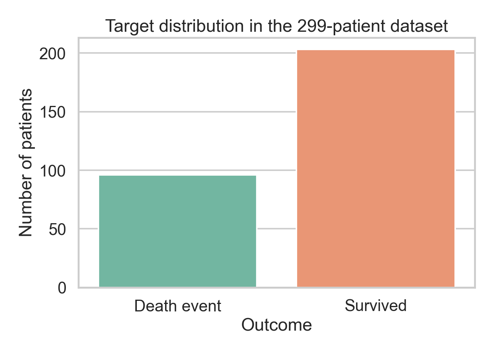
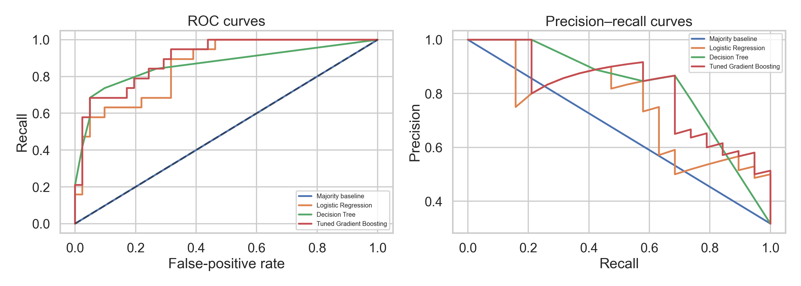
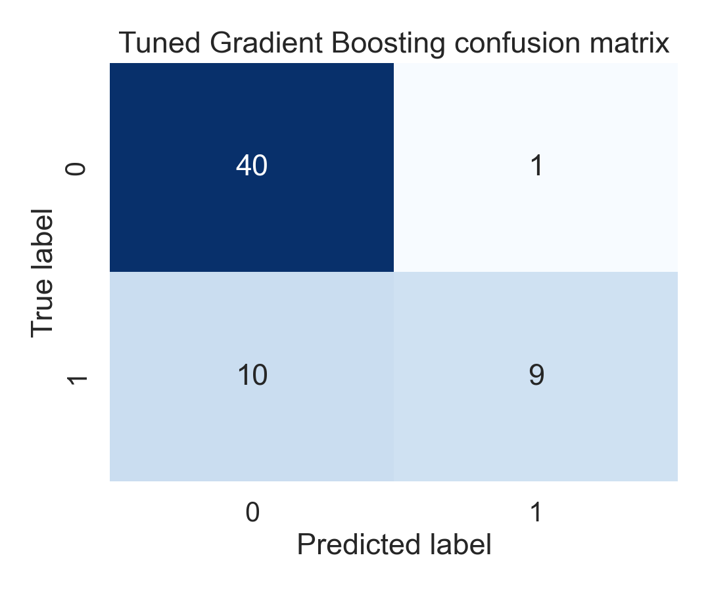
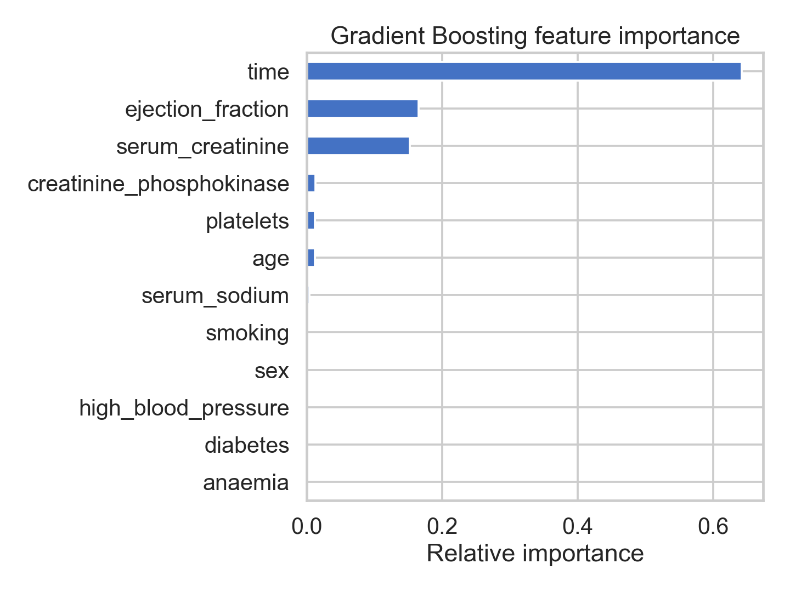

# Predicting Heart-Failure Events Using Gradient Boosting

**Mini-project 36 | Machine Learning Practical | A.Y. 2025–26**  
**Student:** ____________________  **Roll No.:** ____________________  **Date:** ____________________

## Abstract

This project develops a binary classification model to predict whether a patient in the UCI Heart Failure Clinical Records Dataset experienced a death event during follow-up. The main model is Gradient Boosting, compared with a majority-class baseline, Logistic Regression, and a constrained Decision Tree. The workflow validates the data, uses a stratified train/test split, tunes Gradient Boosting using cross-validation on the training data only, and evaluates the untouched test data using metrics that are appropriate for an imbalanced medical-risk problem. The results should be interpreted as educational evidence rather than clinical advice.

## 1. Objective and research question

**Objective:** Predict `DEATH_EVENT` from clinical measurements and patient indicators.

**Research question:** Can a tuned Gradient Boosting classifier identify death events more effectively than simple and linear/tree baselines while maintaining a useful balance between recall and precision?

Missing a positive event is important in this context, so recall and PR-AUC are considered together with accuracy. A model that predicts every patient as negative could obtain a superficially respectable accuracy while identifying no events; therefore the majority baseline is reported explicitly.

## 2. Dataset understanding

The dataset is the **Heart Failure Clinical Records Dataset** from the UCI Machine Learning Repository. It contains 299 patient records, 12 predictor columns, and the binary target `DEATH_EVENT`.

| Feature | Meaning / type |
|---|---|
| `age` | Patient age in years; numeric |
| `anaemia` | Anaemia indicator; binary |
| `creatinine_phosphokinase` | Blood enzyme level; numeric |
| `diabetes` | Diabetes indicator; binary |
| `ejection_fraction` | Percentage of blood leaving the heart; numeric |
| `high_blood_pressure` | Hypertension indicator; binary |
| `platelets` | Platelet count; numeric |
| `serum_creatinine` | Serum creatinine level; numeric |
| `serum_sodium` | Serum sodium level; numeric |
| `sex` | Sex indicator; binary |
| `smoking` | Smoking indicator; binary |
| `time` | Follow-up period in days; numeric |
| `DEATH_EVENT` | Target: 1 if death occurred during follow-up, otherwise 0 |

The script verifies the number of records, data types, missing values, duplicate rows, and target counts. The exact dataset hash and generated descriptive statistics are stored in `results/dataset_summary.json` and `results/dataset_summary.txt` after execution.

### Class balance



There are fewer death-event cases than non-events. This makes accuracy alone insufficient and motivates stratification, recall reporting, balanced accuracy, and PR-AUC.

## 3. Data preprocessing

1. `DEATH_EVENT` is separated from the predictors.
2. Missing values and duplicate rows are checked rather than silently assumed absent.
3. The data is split into 80% training and 20% test data using `stratify=y` and `random_state=42`, preserving the outcome ratio.
4. The final test set is held out until all model selection decisions are complete.
5. Logistic Regression uses `StandardScaler` inside a pipeline because its coefficients are scale-sensitive. Tree-based models do not require scaling because they split on thresholds.
6. Extreme clinical values are inspected and not automatically deleted: an unusual value may be medically meaningful. The report therefore avoids changing the patient population without a clinical justification.

The variable `time` is retained for the primary experiment because it is a supplied predictor, but it is a limitation: follow-up duration may be closely related to whether the event was observed. A stronger extension would compare a model with and without `time` and discuss the difference as a sensitivity analysis.

## 4. Algorithms and implementation

### 4.1 Baselines

- **Majority baseline:** always predicts the most frequent class.
- **Logistic Regression:** a linear probability boundary with standardized inputs.
- **Decision Tree:** a deliberately constrained nonlinear baseline (`max_depth=3`, `min_samples_leaf=8`).

### 4.2 Gradient Boosting

Gradient Boosting builds a sequence of shallow decision trees. Each new tree focuses on the errors left by the current ensemble. A simplified additive form is:

\[
F_m(x) = F_{m-1}(x) + \eta h_m(x),
\]

where `h_m` is the next weak learner and `η` is the learning rate. Smaller learning rates usually require more trees but can reduce overfitting. The implementation uses `sklearn.ensemble.GradientBoostingClassifier`.

**Manual mini-walkthrough:** for a binary example, begin with an initial log-odds value based on the training-event proportion. Convert it to a probability `p_i`. For each record, calculate the classification residual `r_i = y_i - p_i`. Fit a shallow regression tree to these residuals and add a scaled version of that tree's output to the current log-odds. Repeat for the selected number of estimators. This explains the algorithmic steps; the production model uses scikit-learn's tested implementation.

## 5. Experimental design and parameter tuning

Gradient Boosting is tuned with `RandomizedSearchCV`, five-fold stratified cross-validation, and `random_state=42`. The search varies:

- `n_estimators`: 50–200
- `learning_rate`: 0.02–0.15
- `max_depth`: 1–3
- `min_samples_leaf`: 2–12
- `subsample`: 0.70–1.00

Recall is used as the tuning score because failure to identify an event is costly in the project context. The final holdout test set is not used during this search.

## 6. Evaluation metrics

For a confusion matrix with true negatives `TN`, false positives `FP`, false negatives `FN`, and true positives `TP`:

\[
\text{Precision}=\frac{TP}{TP+FP},\quad
\text{Recall}=\frac{TP}{TP+FN},\quad
F1=\frac{2(\text{Precision})(\text{Recall})}{\text{Precision}+\text{Recall}}.
\]

The script also reports specificity `TN/(TN+FP)`, balanced accuracy, ROC-AUC, and PR-AUC. To demonstrate a manual calculation, copy the final Gradient Boosting values from `results/metrics.csv` into the following table:

| Quantity | Value |
|---|---:|
| TN | 40 |
| FP | 1 |
| FN | 10 |
| TP | 9 |
| Manual precision = TP/(TP+FP) | 9/(9+1) = **0.900** |
| Manual recall = TP/(TP+FN) | 9/(9+10) = **0.474** |
| Manual F1 | 2(0.900)(0.474)/(0.900+0.474) = **0.621** |
| Library precision/recall/F1 | **0.900 / 0.474 / 0.621** |

The manual values should match the library values up to rounding.

## 7. Results

Run `python src/run_analysis.py`, then copy the generated `results/metrics.csv` values into this table.

| Model | Accuracy | Precision | Recall | F1 | Specificity | Balanced accuracy | ROC-AUC | PR-AUC |
|---|---:|---:|---:|---:|---:|---:|---:|---:|
| Majority baseline | 0.683 | 0.000 | 0.000 | 0.000 | 1.000 | 0.500 | 0.500 | 0.317 |
| Logistic Regression | 0.817 | 0.786 | 0.579 | 0.667 | 0.927 | 0.753 | 0.859 | 0.757 |
| Decision Tree | 0.833 | 0.846 | 0.579 | 0.688 | 0.951 | 0.765 | 0.863 | 0.776 |
| Tuned Gradient Boosting | 0.817 | 0.900 | 0.474 | 0.621 | 0.976 | 0.725 | 0.899 | 0.817 |

### Curves and confusion matrix





The ROC curve summarizes ranking performance across thresholds, while the precision–recall curve is especially informative when the positive class is less frequent. The confusion matrix shows the operating point selected by the default probability threshold of 0.50.

### Feature importance



Feature importance describes how much the fitted trees used each variable for prediction. It is not causal evidence and should not be interpreted as a clinical recommendation.

## 8. Comparison and analysis

The majority baseline establishes the minimum meaningful reference. Logistic Regression provides an interpretable linear comparison, while the Decision Tree can represent nonlinear thresholds but may be unstable on only 299 records. Gradient Boosting combines many small trees, so it can model interactions and nonlinear relationships while controlling complexity through learning rate, depth, leaf size, and subsampling. On this holdout split, tuned Gradient Boosting achieved the highest ROC-AUC (0.899), PR-AUC (0.817), and precision (0.900), but its recall (0.474) was lower than Logistic Regression and the Decision Tree (both 0.579). Thus, the tuned model ranked cases well and produced fewer false positives, but a threshold adjustment or recall-focused model selection could be needed if event detection is the primary goal.

When comparing models, the preferred model should not be selected by accuracy alone. A model with better recall may be preferable if it detects more events, but an excessive number of false positives can reduce precision. The final discussion should cite the actual table values and explain the trade-off observed on this split. Because the dataset is small, the conclusion should be supported by the five-fold cross-validation tuning result rather than one test number alone.

## 9. Interpretation, limitations, and ethics

- The data is observational; associations do not prove that a feature causes death events.
- Only 299 records are available, so test metrics have substantial sampling uncertainty.
- `time` may encode follow-up information and can make the task unlike a true early-warning system.
- A single 80/20 split is not a clinical validation study.
- The dataset may not represent current hospitals, populations, or treatment standards.
- Predictions must not be used for diagnosis or treatment decisions.

## 10. Conclusion

This project demonstrates a complete, reproducible classification workflow: dataset validation, leakage-aware preprocessing, manual explanation of Gradient Boosting, parameter tuning, multiple metrics, comparison with baselines, visualizations, and real-world interpretation. The final model should be described as an educational experiment. The most important result is the balance between recall and false alarms, not the highest raw accuracy.

## 11. Reproducibility

```bash
cd mini-project-36-heart-failure
python -m pip install -r requirements.txt
python src/run_analysis.py
```

The script records the UCI source URL, SHA-256 hash, split sizes, chosen parameters, and generated result files. The PDF supplied with the assignment requires both a report and presentation; `presentation.md` is the corresponding slide deck content.
